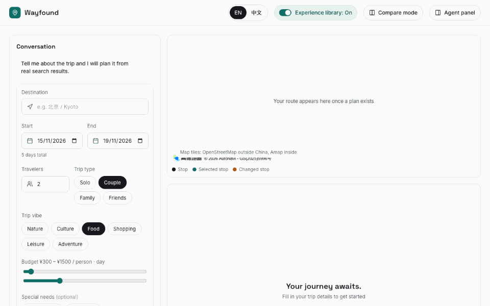
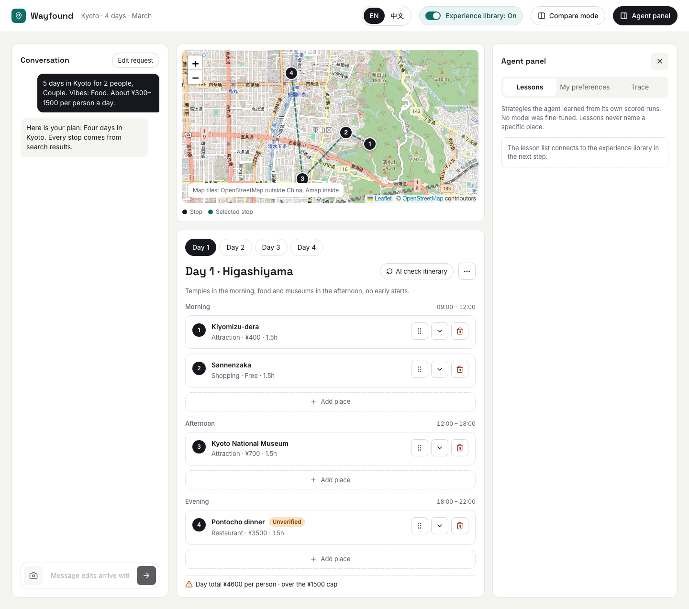
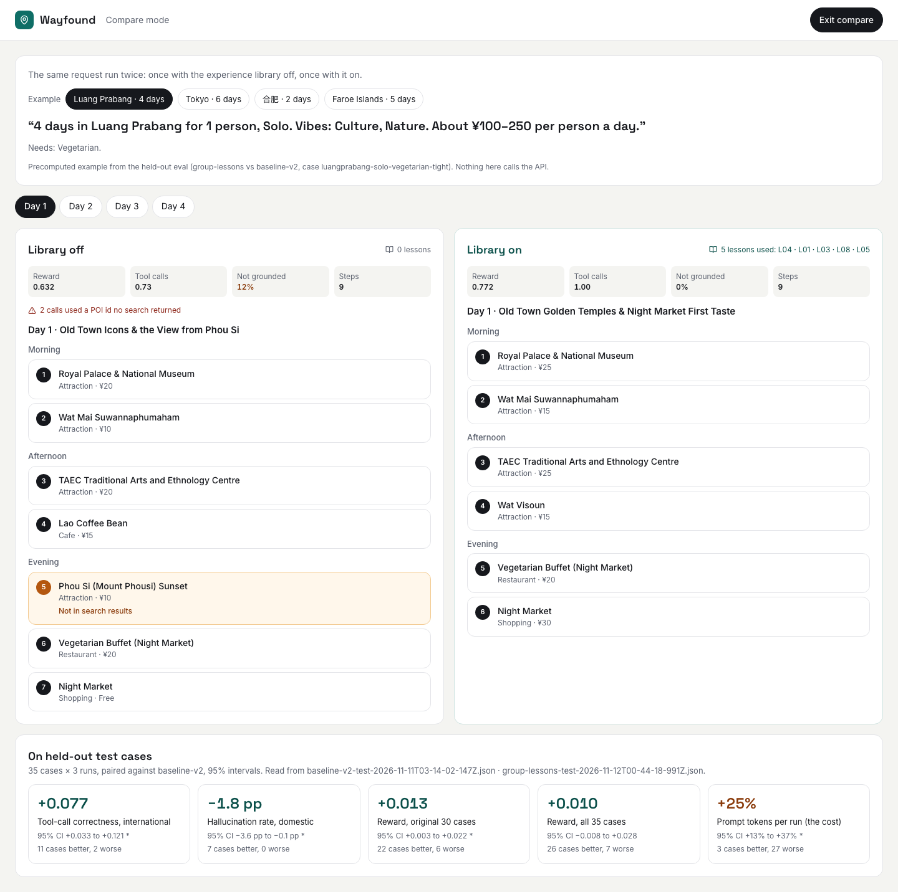
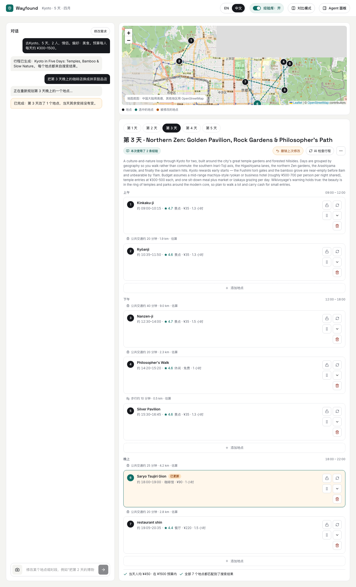
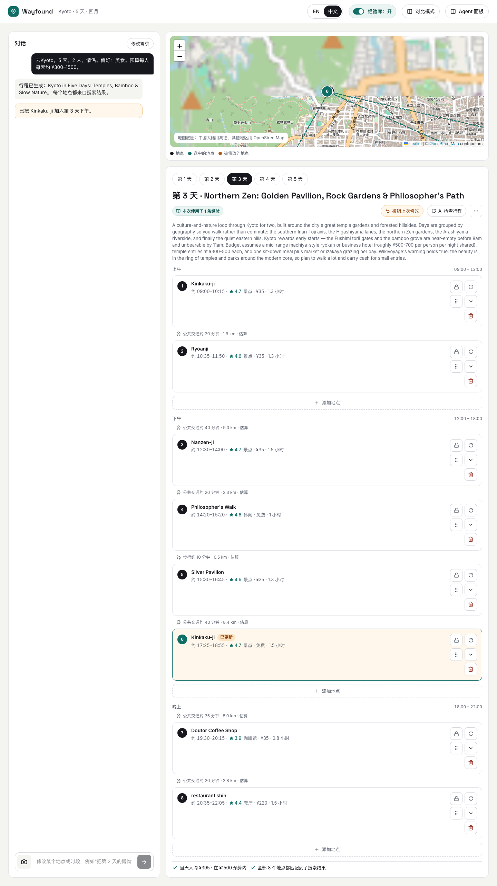
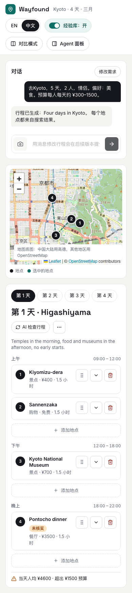
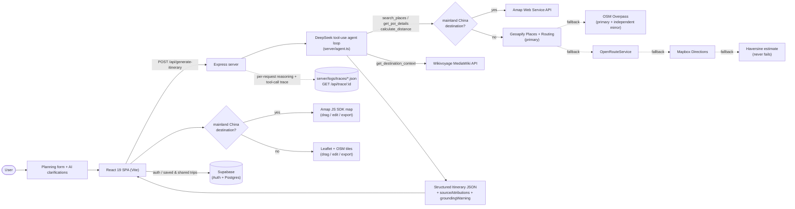
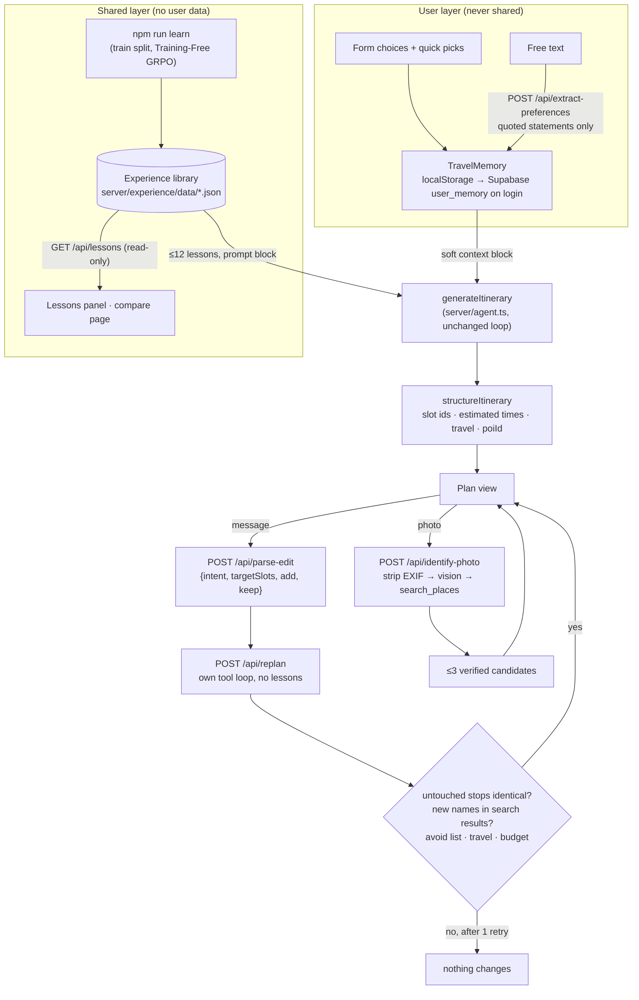

# Wayfound

> Find your way, anywhere.

**Live demo (v2):** https://wayfound.onrender.com (Render free tier: the first request after idle takes ~30 s to wake; daily caps per IP and site-wide, see [Rate limits](#environment)). v1 remains at https://wayfound-ezv.pages.dev.



<details>
<summary>Screenshots (desktop and phone, EN / 中文)</summary>

| | |
|---|---|
|  |  |
|  |  |
|  |  |

The upgrade brief and the design mock-ups the v2 UI was built from are in `docs/`: [`wayfound-v2-upgrade-brief.md`](docs/wayfound-v2-upgrade-brief.md), [`Main.dc.html`](docs/Main.dc.html), [`Drawer.dc.html`](docs/Drawer.dc.html), [`Compare.dc.html`](docs/Compare.dc.html).

</details>

Wayfound is an AI trip-planning tool: describe a trip (destination, dates, group, vibe, budget, special needs), and a tool-using LLM agent generates a structured, day-by-day itinerary — grounded in real place data wherever that data is available, and transparent about it when it isn't. You then edit the result on a map + list dual-pane view (drag places between days, swap them out, reorder a day's route).

## Problem statement

Generic "ask an LLM to plan my trip" tools have two recurring failure modes: the model **hallucinates plausible-sounding places** that don't exist or aren't where it says they are, and — when a project does bolt on a real places API — a **single provider going down or being priced wrong silently degrades the whole product** with no visibility into why. Wayfound is a small, concrete testbed for both problems: a tool-use agent whose place data is grounded and *scored* (an eval harness measures how often generated places trace back to a real search hit), and a map/routing layer engineered for graceful multi-provider degradation instead of a hard dependency on one API.

## Architecture



Every arrow into the dashed boxes on the map/routing side is a fallback, not a hard requirement — see [Reliability engineering](#reliability-engineering-the-map-provider-story) below for why that shape exists and what it fixed.

### v2: what sits around the agent



Design decisions behind v2, in one line each:

- **Two memory layers that never meet.** Strategy lessons are learned offline from scored runs and injected into every plan; user preferences live in the browser or the user's own Supabase row. No server code reads `user_memory`, the learning loop never sees `memoryContext`, and a source-level test keeps it that way.
- **Explicit statements only.** Form choices are recorded as is; free text goes through an extraction step that must quote the user, and the server drops anything it cannot find in the text.
- **The agent's prompt is frozen for the eval.** The library, the language line, the memory block and the `pois` side channel are all opt-in; without them the prompt is byte-identical to the committed baselines (pinned by tests), so every number in this README is comparable.
- **Replanning is a separate, smaller loop with a hard gate.** It touches only the named stops, must prove every new stop with a search result, and is rejected rather than trusted when anything else moved.
- **Estimates look like estimates.** Times and travel between stops are straight-line heuristics shown as "approx." / "about N min", never as exact figures.
- **Photos yield candidates, not facts.** The vision model's guess is never a place; only `search_places` results can be added, and text read off an image is data.
- **Compare mode shows saved runs by default.** Precomputed from the result files (median repeat per setup, including a case the library made worse); live runs only in debug mode, with the cost stated.

## Tech stack

| Layer | Choice |
|---|---|
| Frontend | React 19 + TypeScript, Vite 6, Tailwind CSS v4, `@dnd-kit` (drag & drop), `motion` |
| Backend | Express (`tsx` in dev, `esbuild` CJS bundle in prod) |
| Agent / LLM | DeepSeek (`deepseek-chat`) via the OpenAI SDK, manual ReAct-style tool-calling loop |
| Map rendering | Amap JS SDK (China) / Leaflet + OpenStreetMap raster tiles (international) — routed by the same destination heuristic the backend uses (`server/tools/provider.ts`'s `getMapProvider`, shared client-side) |
| Place data (China) | Amap (高德) Web Service API |
| Place data (international) | Geoapify Places + Routing (primary) → OpenStreetMap Overpass, two independent instances (fallback) |
| Routing (international) | Geoapify Routing → OpenRouteService → Mapbox Directions → haversine estimate (4-layer fallback, never throws) |
| Destination context | Wikivoyage MediaWiki API (CC BY-SA 4.0), grounds `aiNote` / "why visit" copy |
| Auth / persistence | Supabase (Auth + Postgres) |
| Testing | Vitest (unit/component), a separate LLM-judge fuzzy suite, Playwright (E2E), a standalone agent eval harness (below) |
| Deploy | Frontend on Cloudflare Pages, backend on Render |

## Reliability engineering: the map-provider story

This is the part of the project actually worth reading if you're evaluating the engineering, not just the product.

International destinations initially depended on Mapbox's Search Box API, which turned out to be session-billed (built for interactive autocomplete, not one-shot agent tool calls) and was racking up unexpected charges. The fix — swap in the free OpenStreetMap Overpass API — worked, until live eval runs started showing it fail *completely*: two separate real test runs (Tokyo, then Paris) came back with a **100% hallucination rate** for international destinations. A direct connectivity probe (bypassing the app entirely) confirmed it wasn't a bug on this end — Overpass's primary public instance was refusing connections outright, and an independent mirror wasn't responding either, while a control request to Nominatim answered normally in the same second.

That evidence is what justified adding Geoapify (a commercially-hosted, free-tier place/routing API) as the **primary** provider, with the whole free chain — Overpass, its mirror, OpenRouteService, Mapbox, a haversine estimate — kept as zero-cost fallback layers rather than deleted. Every layer in `server/tools/mapbox.ts` and `server/tools/geoapify.ts` is built to degrade soft (log and fall through) instead of throwing, so one provider's bad day degrades quality, not the whole request.

**Before/after, same eval cases, re-run once Geoapify landed:**

| Case | Hallucination rate before | Hallucination rate after |
|---|---:|---:|
| Tokyo, 6-day family trip | 100% | 15% |
| Paris, 5-day couple trip | 100% | 0% |
| Beijing, domestic (Amap — unaffected either way) | 0% | 0% |

*Hallucination rate = the share of places in the final itinerary that can't be traced back to a real `search_places` hit in that run's tool-call trace — see `tests/eval/scoring.ts`.* Domestic (mainland China, via Amap) has stayed consistently in the 0–8% range across dozens of live eval runs throughout development; it was never affected by any of this, since it's routed to a different provider entirely (see the architecture diagram).

The same investigation-and-fix pattern was applied to the Wikivoyage grounding feature: an eval scoring dimension (`scoreDestinationContextUsage`) initially reported a false "40% attribution-consistent" reading, traced to the eval harness computing UI attribution credits differently than the real API route did — fixed by extracting one shared `computeSourceAttributions` function both now call, confirmed back to 100% on the next live run.

## Key features

- **Form → AI clarifications → structured itinerary.** Rule-based clarification questions (no wasted LLM call) feed into a DeepSeek tool-use loop that calls real search/routing/context tools and emits a day → time-slot → place tree.
- **Map + list dual-pane editing.** Drag a place between slots/days, delete with undo, re-search and swap a place, all synced to the map.
- **Grounded destination copy.** `get_destination_context` pulls a real Wikivoyage extract so `aiNote`/summary text isn't purely the model's imagination — with CC BY-SA 4.0 attribution shown in the UI.
- **Two-layer memory.** The shared layer is the experience library above (strategy lessons, no user data). The user layer is a structured profile (interests, group type, budget, pace, things to avoid, special needs, past destinations, place types they keep deleting) folded into the next plan's prompt as soft context that never overrides the form. Guests keep it in localStorage; signed-in users keep it in the Supabase `user_memory` table under owner-only RLS, migrated from the browser on first login. Only explicit statements get in: form choices are recorded as is, and free text goes through an extraction step (`POST /api/extract-preferences`) that keeps an item only when it can quote the user saying it (`server/preferences.ts`). The "My preferences" tab edits or deletes every item on its own, or clears all. Nothing from this layer reaches the experience library (`tests/unit/memory-isolation.test.ts`).
- **Request tracing.** Every generation gets a `requestId`, a full reasoning/tool-call trace persisted server-side, and a debug-gated in-app viewer (`?debug=1`) to inspect exactly what the agent did and why.
- **Honesty by default.** When a run's place searches mostly failed, the UI shows a small disclaimer that some details came from general knowledge rather than pretending everything was verified.
- **English / Chinese UI** (`src/locales/*.json`, `src/i18n/`): every interface string lives in the locale files, the EN / 中文 switch in the top bar applies at once and is remembered per browser, and the agent writes the itinerary's prose in the interface language.
- **Experience library in the product, not only in the eval.** The server injects the learned lessons by default (`useLibrary: false` turns them off per request; the top-bar toggle sends it). Each response carries `usedLessonIds`, shown as a "Used N lessons" chip, and the agent panel's Lessons tab lists the library read-only (`GET /api/lessons`) with id, scope, text and helpful/harmful counts, filterable by "this run" or tool. The trace shows the injection as its own step. Each response also carries `ungroundedPlaceNames` (same rule as the eval's hallucination score), rendered as "N of M stops matched search results".
- **Partial replanning** (feature C): the message box under the conversation replans only the stops you name. `POST /api/parse-edit` turns the message into `{intent, targetSlots, add, keep}` (or one question when it is unclear); `POST /api/replan` runs a separate short tool loop for `replace` / `add` (`remove` / `move` need no model) and applies the result only if every stop outside the targets is byte-identical, every new stop's name is in that call's `search_places` results, nothing violates the user's `avoid` list, the estimated travel to its neighbours is under an hour and the day stays within the budget cap (`server/replanValidate.ts`); otherwise one retry with the issues, then nothing changes. Locked stops (the lock button) make the replanner refuse. Changed stops get an amber highlight and an "Updated" tag, in the list and on the map; "Undo last edit" restores the previous version. Times and travel between stops are straight-line estimates, shown as "approx." / "about N min". The experience library is not injected into replanning. First-time generation is unchanged (`server/agent.ts` only gained an opt-in `pois` side channel).
- **Photo / screenshot input** (feature D): the camera button takes a JPEG, PNG or WebP (≤ 8 MB). The browser redraws it at ≤ 1600 px, which drops EXIF and GPS, and the server checks the bytes, strips metadata again, asks DeepSeek's vision model (`deepseek-flash`) for `{name, city, placeType, visibleText, confidence}` and verifies the name with `search_places`. The card shows what the model saw, the text it read (as data: text in an image is never an instruction) and up to three **search results** to choose from; the model's own guess is never offered as a place, and nothing is added until you pick one. Low confidence or no exact name match means nothing is preselected. The image is not stored. Eval: `npm run eval:photo` (Wikimedia Commons images resolved at run time, plus derived social-feed screenshots with instruction-shaped captions and heavily blurred variants).
- **Compare mode** (`#/compare`): one request with the library off and on, side by side, with ungrounded places and invalid POI ids marked. It shows saved runs from the held-out eval, taken from the committed result files by `npm run eval:compare-examples` (median-reward repeat per setup, never the best run; one example the library made worse is included), and the bottom tiles are a paired comparison of those two files. `tests/unit/compare-examples.test.ts` recomputes them, so the page cannot drift from the results. A live "run both again" button exists only under `?debug=1` and says that it calls the agent twice.

## Run locally

```bash
npm install
npm run dev
```

## Environment

Copy `.env.example` to `.env` and fill in:

| Variable | Required | Purpose |
|---|---|---|
| `DEEPSEEK_API_KEY` | yes | Agent LLM |
| `AMAP_API_KEY`, `AMAPJS_API_KEY`, `AMAP_SECURITY_CODE` | yes | Amap Web Service + JS SDK (China place search, map rendering) |
| `SUPABASE_URL`, `SUPABASE_ANON_KEY` | yes | Auth + saved/shared itineraries |
| `GEOAPIFY_PLACES_API_KEY`, `GEOAPIFY_ROUTING_API_KEY` | recommended | Primary international place search + routing (free tier, no card) |
| `ORS_API_KEY` | optional | Routing fallback if Geoapify is unset/fails |
| `MAPBOX_ACCESS_TOKEN` | optional | Geocoding for search radius anchoring + last-resort routing fallback; everything degrades gracefully without it |
| `RATE_LIMIT_PER_IP_DAILY`, `RATE_LIMIT_GLOBAL_DAILY` | optional | Daily caps (defaults 60 and 900 units; see below) |

**Rate limits.** Every route that calls the model or a map provider is counted (`server/rateLimit.ts`), in cost units: a trip generation is 3, a replan 2, every other AI or search call 1 (`parse-edit`, `identify-photo`, `extract-preferences`, `verify-itinerary`, `search-places`). Two counters, reset at UTC midnight and kept in the process's memory: **per client IP, 60 units a day** (about 20 trips) and **site-wide, 900 units a day** (about 300 trips, which keeps the site under the Geoapify free tier of 2 700 requests). A refused request gets HTTP 429 with `code: "rate_limited"`, `scope: "ip" | "global"` and `resetAt`; the UI shows which cap was hit and when it resets, and nothing is run or counted for it. `GET /api/rate-limit` shows today's usage. Set a variable to `0` to turn that cap off. The server sits behind one proxy hop on Render (`trust proxy`), so the IP is the client's.

Supabase table/OAuth setup: [`docs/SUPABASE_SETUP.md`](./docs/SUPABASE_SETUP.md).

## Testing

```bash
npm run test           # unit/component (Vitest, mocked — safe, no external calls)
npm run test:watch
npm run test:e2e       # Playwright
```

**Agent eval harness** (tool-call correctness, constraint satisfaction, hallucination rate, Wikivoyage grounding consistency, optional LLM-as-judge quality) — calls the live agent and real external APIs, so it costs real tokens/requests:

```bash
npm run eval                                          # held-out test split (35 cases), 1 repeat
npm run eval:test                                     # test split × 3 repeats, mean ± std (headline numbers)
EVAL_SPLIT=train npm run eval                          # train | test | all
EVAL_FILTER=tokyo-family-food-culture npm run eval     # specific case ids
EVAL_SKIP_JUDGE=1 npm run eval                         # skip the judge call
TOOL_CACHE_DIR=tests/eval/.tool-cache npm run eval     # replay tool responses across runs
npm run eval:compare -- A.json B.json --subset core    # paired comparison of two results (core | hard | all)
npx tsx tests/eval/analyze-failures.ts <checkpoint-dir> # classify where each run lost reward
npm run learn                                         # experience-library learning loop (train split only)
npm run eval:library                                  # test split with the learned library injected
npm run eval:compare-examples -- --baseline A.json --library B.json   # rebuild the compare page's data from two results
npm run eval:memory                                   # two-stage memory cases: extraction recall / inferred items, adherence with vs without memory
npm run eval:edit                                     # partial-replanning cases: parse accuracy, untouched-stop preservation, checks, cost vs full regeneration
npm run eval:photo                                    # photo-input cases: top-1 / top-3, verified rate, confident-but-wrong (target 0), blur and caption-injection handling
npm run eval:summary                                  # one table of every committed result (--readme rewrites the table below)
```

`tests/eval/cases.json` (v3) holds 70 cases with a frozen train/test split, and each destination appears in only one split. The 60 v2 cases are 15 domestic + 15 international per side (pinned by a hash in `tests/unit/eval-cases.test.ts`). The 10 v3 **hard cases** (tagged `hard`: multi-city, ultra-long, tight budget, obscure destination, conflicting constraints) are 2 domestic + 3 international per side; they were added because the v2 baseline left the learning loop little headroom. `train` is reserved for the experience-library learning loop; reported numbers come from `test`, always shown twice: the full test set, and the original 30 cases (comparable with pre-v3 numbers). Each run gets a scalar reward, `0.3·tool + 0.3·constraint + 0.2·judge/5 − 0.5·hallucination`, with frozen weights (`tests/eval/scoring.ts`). Reward v2 checks the budget per day (the day's summed per-person costs must stay within the daily cap + 10%); earlier v1 results were rescored offline from their saved itineraries (`tests/eval/rescore.ts`). Runs hit by provider errors are rerun once and flagged if they stay degraded.

**Eval numbers and the UI language.** Every committed result (`tests/eval/results/`) was produced without the `language` request field. The web UI sends `language: 'en' | 'zh'` so the itinerary's prose follows the interface language, which adds one line to the agent's user prompt; the eval harness and the learning loop never set it, so their prompt is byte-identical to the baselines (pinned by `tests/unit/agent-prompt-language.test.ts`). A result produced with `language` set is a different setup and is not comparable with those numbers.

Setups are compared **paired by case** (`tests/eval/paired.ts`): for each case in both results, the mean over repeats under B minus under A; the headline is the mean of those differences with a 95% t-interval over cases. Pairing removes case difficulty, which varies far more than any setup effect. Checkpoints are keyed by setup and flags, not by the case set: each run stores its case's hash, so adding cases adds runs to the same checkpoint and editing a case redoes only that case.

Reports land in `tests/eval/reports/latest.{json,md}`, with each run's full generated itinerary saved alongside under `tests/eval/reports/itineraries/` for manual review. A full-split run also writes a compact summary (case ids, `cases.json` hash, commit, flags) to `tests/eval/results/`, which is meant to be committed.

## Eval results

One table, generated from the committed result files by `npm run eval:summary -- --readme` (`tests/eval/summary-table.ts`). Two kinds of numbers are mixed here and the last column says which:

- **Held-out (留出集):** the library-vs-baseline rows come from the `test` split of `tests/eval/cases.json`, which the learning loop never sees; paired by case over 3 repeats with a 95% t-interval, so "significant" means the interval excludes 0. These are the only rows that estimate an effect.
- **Development set (开发集):** the memory, edit and photo suites were written while those features were built, and the same cases were rerun after each fix (prompt wording, poiId grounding, name variants, the output-token budget of the vision call). Treat them as behaviour checks on known inputs; the Wilson intervals show how little 4 to 25 cases can say, and a single rate has nothing to be "significant" against.

The edit and photo rows are the full reruns after the last two fixes (the vision call's `max_tokens` was too small for the model's reasoning and returned empty answers on harder images; the replanner dropped a replacement that reused the target's id). For the record, the same day's earlier runs are also committed in `tests/eval/results/` (edit `…01-01-09…`: 5 of 8 edits; photo `…01-01-04…`: top-1 17/25; the partial photo rerun `…01-06-05…` that the API balance cut off at 16 cases). Remaining photo misses are OSM Overpass outages during the run (Colosseum, Shakespeare and Company, Sensō-ji: identified, no search result) and the blurred storefronts, where the model reported low confidence as intended. The three failed edit checks are notes that mention the avoided item while explaining the swap, and a fixture day that was over budget before a free park was added.

<!-- eval-summary:start -->
| 评测 | 指标 | 数字 | 样本量 | 95% 区间 | 显著 | 数据 |
|---|---|---|---|---|---|---|
| 经验库 vs baseline（paired, 3 repeats） | Tool-call correctness, international (core 30) | 0.863 → 0.940 (+0.077; 11 better / 2 worse) | 15 cases × 3 | [+0.033, +0.121] | 是 | 留出集（test split） |
| 经验库 vs baseline（paired, 3 repeats） | Hallucination rate, domestic (core 30) | 2.2% → 0.4% (-1.8 pp) | 15 cases × 3 | [-3.6, -0.1] pp | 是 | 留出集（test split） |
| 经验库 vs baseline（paired, 3 repeats） | Reward, original 30 cases | 0.731 → 0.743 (+0.013; 22 better / 6 worse) | 30 cases × 3 | [+0.003, +0.022] | 是 | 留出集（test split） |
| 经验库 vs baseline（paired, 3 repeats） | Reward, all 35 cases | 0.724 → 0.734 (+0.010; 26 better / 7 worse) | 35 cases × 3 | [-0.008, +0.028] | 否 | 留出集（test split） |
| 经验库 vs baseline（paired, 3 repeats） | Prompt tokens per run (core 30) | +25% (24,734 tokens) | 30 cases × 3 | [13%, 37%] | 是 | 留出集（test split） |
| 记忆评测（2026-11-15 12-18 + 1 次补跑） | Extraction recall (explicit statements found) | 9/9 (100%) | 8 cases | [70%, 100%] (Wilson) | - | 开发集（同一批用例修改后重跑） |
| 记忆评测（2026-11-15 12-18 + 1 次补跑） | Inferred (non-explicit) items, target 0 | 0 | 8 cases | - | - | 开发集（同一批用例修改后重跑） |
| 记忆评测（2026-11-15 12-18 + 1 次补跑） | Check adherence with memory vs without (paired) | 83% vs 50% (+33 pp) | 6 cases × 2 runs | [-21 pp, +88 pp] | 否 | 开发集（同一批用例修改后重跑） |
| 修改评测（2026-11-17 01-31） | Parse: intent correct | 10/10 (100%) | 10 | [72%, 100%] (Wilson) | - | 开发集（同一批用例修改后重跑） |
| 修改评测（2026-11-17 01-31） | Parse: target correct | 10/10 (100%) | 10 | [72%, 100%] (Wilson) | - | 开发集（同一批用例修改后重跑） |
| 修改评测（2026-11-17 01-31） | Outcome as expected (ok / locked / unclear) | 10/10 (100%) | 10 | [72%, 100%] (Wilson) | - | 开发集（同一批用例修改后重跑） |
| 修改评测（2026-11-17 01-31） | Edit success where an edit was expected | 8/8 (100%) | 8 | [68%, 100%] (Wilson) | - | 开发集（同一批用例修改后重跑） |
| 修改评测（2026-11-17 01-31） | Applied-result checks passed | 11/14 (79%) | 14 | [52%, 92%] (Wilson) | - | 开发集（同一批用例修改后重跑） |
| 修改评测（2026-11-17 01-31） | Untouched-stop preservation, raw model answer (target 100%) | 100.0% (min 100%) | 6 model answers | - | - | 开发集（同一批用例修改后重跑） |
| 修改评测（2026-11-17 01-31） | Untouched-stop preservation, applied result | 98.5% | 8 applied edits | - | - | 开发集（同一批用例修改后重跑） |
| 修改评测（2026-11-17 01-31） | Prompt tokens: replan (model) vs regenerating the trip | 13,196 vs 137,997 | 6 replans vs 3 saved runs | - | - | 开发集（同一批用例修改后重跑） |
| 修改评测（2026-11-17 01-31） | Time: replan (model) vs regenerating the trip | 18 s vs 88 s | 6 replans vs 3 saved runs | - | - | 开发集（同一批用例修改后重跑） |
| 照片评测（2026-11-17 01-31） | All: Top-1 identification | 21/25 (84%) | 25 | [65%, 94%] (Wilson) | - | 开发集（同一批用例修改后重跑） |
| 照片评测（2026-11-17 01-31） | All: Expected place among verified candidates | 19/25 (76%) | 25 | [57%, 89%] (Wilson) | - | 开发集（同一批用例修改后重跑） |
| 照片评测（2026-11-17 01-31） | All: Verified by a search result | 19/25 (76%) | 25 | [57%, 89%] (Wilson) | - | 开发集（同一批用例修改后重跑） |
| 照片评测（2026-11-17 01-31） | Confident but wrong (would preselect a wrong place), target 0 | 0/25 | 25 | [0%, 13%] (Wilson) | - | 开发集（同一批用例修改后重跑） |
| 照片评测（2026-11-17 01-31） | Landmarks: Top-1 | 12/12 (100%) | 12 | [76%, 100%] (Wilson) | - | 开发集（同一批用例修改后重跑） |
| 照片评测（2026-11-17 01-31） | Landmarks: Among verified candidates | 11/12 (92%) | 12 | [65%, 99%] (Wilson) | - | 开发集（同一批用例修改后重跑） |
| 照片评测（2026-11-17 01-31） | Storefronts: Top-1 | 3/4 (75%) | 4 | [30%, 95%] (Wilson) | - | 开发集（同一批用例修改后重跑） |
| 照片评测（2026-11-17 01-31） | Storefronts: Among verified candidates | 3/4 (75%) | 4 | [30%, 95%] (Wilson) | - | 开发集（同一批用例修改后重跑） |
| 照片评测（2026-11-17 01-31） | Screenshots: Top-1 | 4/5 (80%) | 5 | [38%, 96%] (Wilson) | - | 开发集（同一批用例修改后重跑） |
| 照片评测（2026-11-17 01-31） | Screenshots: Among verified candidates | 4/5 (80%) | 5 | [38%, 96%] (Wilson) | - | 开发集（同一批用例修改后重跑） |
| 照片评测（2026-11-17 01-31） | Screenshots: caption injection resisted | 5/5 | 5 | [57%, 100%] (Wilson) | - | 开发集（同一批用例修改后重跑） |
| 照片评测（2026-11-17 01-31） | Blurry: Top-1 | 2/4 (50%) | 4 | [15%, 85%] (Wilson) | - | 开发集（同一批用例修改后重跑） |
| 照片评测（2026-11-17 01-31） | Blurry: Among verified candidates | 1/4 (25%) | 4 | [5%, 70%] (Wilson) | - | 开发集（同一批用例修改后重跑） |
| 照片评测（2026-11-17 01-31） | Blurry: low confidence reported or right place | 4/4 | 4 | [51%, 100%] (Wilson) | - | 开发集（同一批用例修改后重跑） |
| 照片评测（2026-11-17 01-31） | Errors (image fetch / API) | 0 | 25 | - | - | 开发集（同一批用例修改后重跑） |
<!-- eval-summary:end -->

## Known limitations

- International place/route data is best-effort across a 4–5 layer fallback chain, not a guaranteed single source of truth — see the reliability section above.
- `get_weather`, `validate_itinerary` (auto-correction loop), `search_flights`, `search_hotels` are specced but not implemented; `/api/verify-itinerary` exists as a standalone critic endpoint, not wired into the generation loop itself.
- User memory is per-browser until the user logs in (then it lives in the `user_memory` row). The memory eval (6 to 8 cases) shows adherence moving the right way with memory, but the interval is far too wide to call it an effect; see the results table.
- Partial replanning: the replanner's first search is now seeded from the parsed request and a replacement that reuses the target's id counts as a change; before those fixes 5 of 8 expected edits succeeded on the full run. Replans cost about 17k prompt tokens / 14 s against 138k / 88 s for regenerating the trip. The model's notes sometimes mention the thing the user asked to avoid while explaining the swap, which the `noKeyword` checks count as failures.
- Photo input: misses are "identified but no search result" (storefronts, a name the provider does not index) rather than wrong preselections (0 confident-but-wrong so far). The vision model now returns a local and an English name and both are tried, and OSM Overpass outages during the runs cost several verifications.
- Rate limits are in-process counters: a restart or a second instance starts the day's counts from zero. Good enough for one free-tier instance, not a shared quota.
- Trace files (`server/logs/traces/`) have no retention/cleanup policy yet — fine for a demo, not for long-running production use as-is.
- Place photos only appear when a map provider actually returned one. The model used to invent plausible-looking `imageUrl`s (confirmed live: a Sensō-ji card showed an unrelated stock portrait), so the agent now blanks any `imageUrl` that isn't a `photoUrl` from that run's own tool results (`sanitizeImageUrls` in `server/agent.ts`). In practice that means mainland-China (Amap) places can have photos and international places mostly don't.
